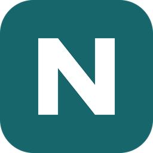

# Notium

**내 기기에 먼저 기록하고, 원할 때 내 Google Drive와 동기화하는 개인 노트 앱**

[다운로드](#다운로드) · [새 기능](#v0228-새-기능) · [시작하기](#시작하기) · [AI와 함께 쓰기](#ai와-함께-쓰기) · [개인정보](#개인정보와-데이터) · [문의](#문의)

---

> [!NOTE]
> 이 저장소는 Notium의 **설치 파일과 릴리스 정보**만 제공합니다. 소스 코드는 포함되어 있지 않습니다.

## 다운로드

<table>
  <tr>
    <th align="left">플랫폼</th>
    <th align="left">파일</th>
    <th align="left">비고</th>
  </tr>
  <tr>
    <td><b>Windows</b> 10/11 x64</td>
    <td>
      
    </td>
    <td>앱 안에서 자동 업데이트</td>
  </tr>
  <tr>
    <td><b>Android</b> arm64</td>
    <td>
      
    </td>
    <td>이전 버전 위에 덮어 설치</td>
  </tr>
  <tr>
    <td><b>iOS</b></td>
    <td colspan="2">아직 제공하지 않습니다.</td>
  </tr>
</table>

버전별 파일과 변경 내역은 [Releases](https://github.com/nonDeveloper0/Notium-releases/releases)에 있습니다. 내려받은 파일은 릴리스의 `SHA256SUMS.txt`로 확인할 수 있습니다.

## v0.2.28 새 기능

- **폴더 화면 우클릭 메뉴(PC):** 폴더 화면의 파일·페이지·하위 폴더를 우클릭해 휴지통으로 보낼 수 있습니다.
- **파일 끌어다 놓기 영역 확대(PC):** 표·보드 보기로 연 폴더 화면에도 파일을 끌어다 놓아 추가할 수 있습니다.
- 폴더 색(0.2.24)을 쓰려면 모든 기기를 0.2.24 이상으로 올려 주세요.
- Windows 0.2.5 이상은 설치 창 없이 앱 안에서 업데이트됩니다. Android는 새 APK `Notium-Android-arm64.apk`(0.2.28)를 이전 버전 위에 덮어 설치하세요. Play Protect 경고가 나오면 **세부정보 → 무시하고 설치**.

<b>이전 버전</b>

| 버전    | 주요 변경                                                                                                   |
| ------- | ----------------------------------------------------------------------------------------------------------- |
| v0.2.27 | 일지 연·월 묶음(PC), 캘린더 빈 날짜에서 일지 만들기, 큰 파일 업로드 개선                                    |
| v0.2.26 | 오늘 일지 캘린더(PC), 다른 기기 파일 다운로드(저장 위치 선택), 업로드·다운로드 진행 표시                    |
| v0.2.25 | 폴더에 파일 넣기, 모아보기 '전체' 탭과 보기 방식(큰 아이콘·작은 아이콘·자세히)                              |
| v0.2.24 | 폴더 색상(8가지), 업데이트 확인 버튼 제거(새 버전이 있을 때만 표시)                                         |
| v0.2.23 | Gemini 채팅(PC), 동기화 속도 개선, 폰 아이콘 버튼·PC 이모지 간격 수정                                       |
| v0.2.22 | 폰 페이지 이모지 아이콘, 표 셀 병합·분할, 토글·단축 입력 편집 문제 수정                                     |
| v0.2.21 | AI 추가 안내 개선(Notium 채팅용 AI와 연결 앱을 상태별로 안내)                                               |
| v0.2.20 | AI 채팅 내부 구조 정리(화면·사용법 그대로)                                                                  |
| v0.2.19 | AI 채팅 새 화면(AI·모델 한 번에 고르기, 중지, 오류 카드, 이전 대화 정리)                                    |
| v0.2.18 | 표 칸 세로 정렬(PC), AI 앱을 CLI 없이 연결, AI 연결 도움말                                                  |
| v0.2.17 | 표 칸 배경색, 표 칸 병합·분할(PC), Markdown 내보내기 병합 표                                                |
| v0.2.16 | 글자색·배경색(PC), 표 칸 색, 폰 색상 버튼, 파스텔 배경색                                                    |
| v0.2.15 | 본문 표 만들기(PC·폰), 커서 밀림 수정, 데이터 보호 강화                                                     |
| v0.2.14 | AI 채팅 사용량, 승인 한 번에 처리, zip 읽기, 업데이트 알림 줄, 폴더 보기 수정                               |
| v0.2.13 | PC 다시 로그인 수정(설정 > 계정·동기화), 로그인 후 앱 창 앞으로                                             |
| v0.2.12 | 폰 페이지 순서 바꾸기, 링크는 브라우저로, 검색어 강조, 저장 공간 그래프, 설정 정리                          |
| v0.2.11 | AI 빠른 메모, 기능별 11개 도움말, AI 채팅 입력창 정리                                                       |
| v0.2.10 | 설정 팝업(PC)·설정 탭, 동기화 공간 복구 이동, AI 채팅 내 PC 파일·수정 방식 선택, 링크 표시, 사이드바 검색창 |
| v0.2.8  | 설정 탭 정리(PC 5개·폰 4개), 파일 다시 받기 진행·실패 이유 표시, 폰 도움말, 테마 스위치·검색 강조색         |
| v0.2.7  | AI 파일 쓰기(폴더별 읽기·쓰기), 단축키 설정, Markdown 가져오기(Notion 내보내기 포함), 오늘 일지             |
| v0.2.6  | 간결해진 설정(고급 접기), 폰 설정 탭 넘기기, 기기 목록 정리, 업데이트 알림 안정화                           |
| v0.2.5  | AI가 읽을 수 있는 폴더(로컬 .md·.txt), AI 웹 읽기 스위치                                                    |
| v0.2.4  | 앱 안 업데이트(PC·Android), 검색 Aa·.* 버튼, AI 채팅 모델 선택, MCP 도구 추가, 연결 해제 개선, 폰 하단 탭   |
| v0.2.3  | 앱 안 AI 채팅(Claude Code·Codex), 계정 메뉴, 설치 중 `notium-mcp.exe` 멈춤 수정                             |
| v0.2.2  | 다른 기기 변경을 15초마다 확인, 창으로 돌아오면 즉시 동기화, 폰에서 휴지통으로 이동                         |
| v0.2.1  | 첫 공개 베타. 메모 보드, AI 앱 연결, 2글자 한글 검색, 첨부 개선, Android 패키지 변경                        |

## 주요 기능

| 기록                                    | 정리                           | 동기화와 연결                   |
| --------------------------------------- | ------------------------------ | ------------------------------- |
| 페이지·폴더 트리와 블록 편집기          | 링크·백링크, 태그·속성         | 선택적 Google Drive 동기화      |
| 일지, 할 일, 빠른 메모                  | 본문 검색, 즐겨찾기, 화면 분할 | PC와 Android 사이 동기화        |
| 첨부 파일과 모아보기                    | 버전 기록, 휴지통, 백업        | 앱 안 AI 채팅과 AI 앱 연결(MCP) |
| Markdown 가져오기(Notion 내보내기 포함) | Markdown 내보내기              | 로컬 우선 저장                  |

## 시작하기

<b>Windows 설치</b>

1. 설치 파일을 내려받아 실행합니다.
2. "Windows의 PC 보호" 창이 나타나면 **추가 정보 → 실행**을 누릅니다. 아직 코드 서명이 없어 표시되는 안내입니다.
3. 설치를 마치면 Notium이 실행됩니다. 새 버전은 앱 안에서 안내합니다.

<b>Android 설치</b>

1. APK를 내려받아 엽니다.
2. 요청이 나오면 브라우저나 파일 앱에 **출처를 알 수 없는 앱 설치**를 허용합니다.
3. 설치를 마친 뒤 필요하면 그 권한을 다시 끕니다.

<b>여러 기기 동기화</b>

1. **첫 PC:** 설정 → 계정·동기화 → **Google Drive** → **Google 계정으로 로그인** 후 **이 PC의 노트로 새 공간 만들기**를 선택합니다.
2. **폰이나 다른 PC:** 같은 Google 계정으로 로그인합니다.
   - 새로 설치한 기기라면 **이 계정의 노트로 새로 시작**을 선택합니다. 저장소의 노트를 받아옵니다.
   - 이 기기에 이미 쓴 노트를 함께 합치려면 **이 기기의 노트로 연결**(PC는 **이 PC의 노트로 연결**)을 선택합니다.
3. 앱이 열려 있으면 다른 기기의 변경은 보통 30초 안에, 창이나 앱을 다시 열면 몇 초 안에 반영됩니다.

동기화는 Google Drive의 **앱 전용 숨김 공간**만 사용하며, 일반 Drive 파일에는 접근하지 않습니다.

## AI와 함께 쓰기

| 방식             | 대상                                                                    | 설명                                                                                 |
| ---------------- | ----------------------------------------------------------------------- | ------------------------------------------------------------------------------------ |
| 앱 안 AI 채팅    | Claude Code, Codex                                                      | Notium 안에서 대화하며 노트를 읽고 고칩니다. 사용량은 각 서비스 요금제에서 나갑니다. |
| AI 앱 연결 (MCP) | Claude Desktop, Claude Code, Codex, Cursor, VS Code Copilot, Gemini CLI | 다른 AI 앱에서 Notium 노트를 불러 씁니다. 설정 → AI 앱 연결에서 연결합니다.          |

기본은 읽기 전용이며, 쓰기는 설정과 승인 방식을 따릅니다. AI에게 숨긴 폴더는 어느 방식으로도 보내지 않습니다. 연결한 AI 서비스가 받은 내용은 해당 서비스의 정책을 따릅니다.

## 개인정보와 데이터

- 노트는 기기에 먼저 저장되고, 동기화를 켠 경우에만 내 Google Drive 앱 전용 공간에 올라갑니다.
- [개인정보처리방침](https://nondeveloper0.github.io/Notium-site/privacy.html) · [이용약관](https://nondeveloper0.github.io/Notium-site/terms.html) · [계정·데이터 삭제 안내](https://nondeveloper0.github.io/Notium-site/data-deletion.html)

## 베타 안내

> [!WARNING]
> Notium은 개인이 만든 **베타 버전**이며 있는 그대로 제공됩니다. 프로그램 오류, 동기화 문제, 기기 고장, 클라우드 계정·용량 문제 등으로 노트나 첨부 파일이 손상되거나 사라져도 개발자는 복구하거나 책임지지 않습니다. **중요한 자료는 항상 따로 백업해 두세요.** (PC: 설정 → 데이터 → 백업)

- 기능과 호환성은 바뀔 수 있으며, 동기화는 별도 백업을 대신하지 않습니다.
- v0.2.1부터 Android 패키지 이름이 바뀌어 그 이전 Android 앱 위에는 덮어 설치되지 않습니다. 이전 앱을 지우고 새로 설치한 뒤 같은 Google 계정으로 다시 연결하세요.
- Windows 설치 파일에는 코드 서명이 없습니다.

## 문의

버그 제보와 문의는 [GitHub Issues](https://github.com/nonDeveloper0/Notium-releases/issues)에 남겨 주세요. 공개 게시물에 노트 내용, 개인정보, 비밀번호나 인증 토큰을 올리지 마세요.

개인 프로젝트로 개발하고 있습니다.

